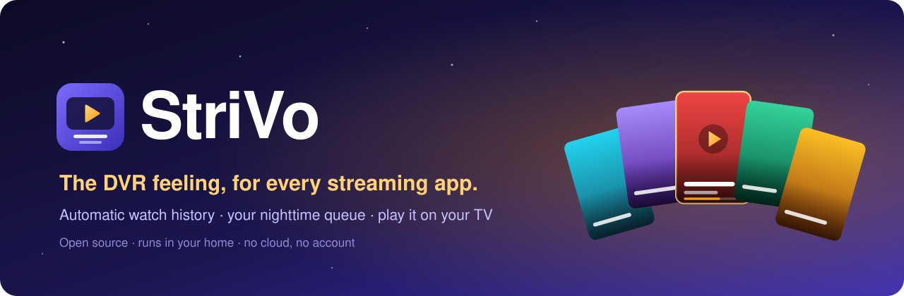
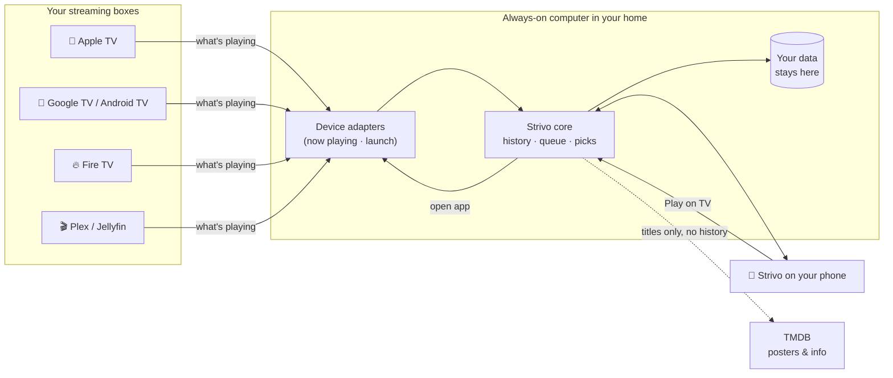

<p align="center">
  
</p>

<p align="center">
  <b>Strivo remembers everything you watch, across every streaming app, without you lifting a finger.</b><br>
  Then it tells you what's next, and plays it on your TV.
</p>

<p align="center">
  <a href="docs/ROADMAP.md"></a>
  <a href="https://github.com/nickdnj/strivo/actions/workflows/ci.yml"></a>
  <a href="LICENSE"></a>
  <a href="docs/COMPATIBILITY.md"></a>
  <a href="https://github.com/nickdnj/strivo/discussions"></a>
</p>

<p align="center">
  <a href="#why-strivo">Why</a> ·
  <a href="#our-philosophy-your-viewing-your-data">Philosophy</a> ·
  <a href="#what-it-does">What it does</a> ·
  <a href="#see-it">See it</a> ·
  <a href="#does-it-work-with-my-tv">Does it work with my TV?</a> ·
  <a href="#getting-started">Getting started</a> ·
  <a href="#how-it-works">How it works</a> ·
  <a href="#roadmap">Roadmap</a> ·
  <a href="#get-involved">Get involved</a>
</p>

<p align="center">
  
</p>

---

## Why Strivo

Remember TiVo? One box knew every show you watched, kept your season passes, and had the next episode ready.

Streaming broke that. Your shows are scattered across six apps, each with its own half-working "Continue Watching" row. Nothing knows the whole picture: what you're in the middle of, what has new episodes tonight, what you gave up on, what you already saw on another service.

Every watch tracker that tried to fix this asked you to **log it yourself**. Nobody keeps that up.

**Strivo's one rule: it has to be fully automatic.** It listens to the streaming box you already own, so your history builds itself. You just watch TV.

> Strivo is **stream + vo**, a nod to the DVR that got it right.

## Our philosophy: your viewing, your data

Open any streaming app today and notice what it's built around. It isn't what you're watching. It's **what you watch next**. Autoplay, the next-episode countdown, the endless rows of "because you watched…": every screen is tuned to keep you in *that* app, on *their* catalog, for one more hour.

To do that, each service keeps a detailed record of what you watch, when and for how long. They use it for themselves: to decide what you see, what to promote, and what to sell you. Apple TV is the least pushy of the boxes, because Apple's business is mostly the hardware, until you open Apple TV+, where it's selling too.

Strivo turns that around:

- **Your history belongs to you.** Strivo keeps one complete record of everything you watch, across every app, on a computer in your home. You can see it, search it, export it and delete it.
- **Recommendations that work for you, not for a catalog.** Strivo doesn't own a library, run ads or earn commissions. Its only job is to help *you* find the next thing *you'd* enjoy, on any service you pay for.
- **Local by default.** Nothing leaves your house unless you choose to share it. There's no Strivo account and no Strivo cloud.
- **Self-healing by design.** Streaming apps change what they report, and integrations break. Strivo notices when an app stops reporting, checks the project for a fix (data, never code), proves the fix worked and tells you. You don't do maintenance. [How it works](docs/SELF-HEALING.md).
- **Share on your terms.** Local by default doesn't mean locked away. If you want to share your watch list with a friend, publish your year in TV, or connect another tool, that's your call, made deliberately, one choice at a time.

Strivo can't stop the streaming services from seeing what you watch in their own apps. But it means **they're no longer the only ones who know**, and the most complete picture of your viewing finally belongs to you.

## What it does

| | |
|---|---|
| 📺 **Watching** | Your nighttime queue: every series you're in the middle of, newest episodes first, across all your apps. Shows drop off when you stop watching them. |
| ▶️ **Play on TV** | Tap a show on your phone, pick a TV, and it opens in the right app. |
| ✨ **Discover** | Movie, series and documentary picks based on what you actually watched, filtered to the services you pay for. Set everyday filters (minimum rating, how many people rated it, years, genres to skip, original language, and an exception for the truly great ones), or try different ones just for now. Tell it *why* you passed ("seen it", "too dark", "not for kids") and it learns. |
| 📰 **Daily** | Morning shows, news, late night and game shows, kept separate so they don't crowd your queue. |
| 🏟️ **Sports** | Every live game across every service, in one place: NFL, college football, NBA, MLB, NHL, golf, soccer and more. Filter by league or team, see which of *your* services carries each game, and open it on your TV. Scores stay hidden until you want them. |
| 🔖 **To Watch** | Your list of what you mean to watch someday, kept apart from Discover, with trailers, reviews, where it's streaming and Play on TV. |
| 🕰️ **History & Stats** | Everything you've watched, on which TV, and when. |
| 🎞️ **Posters view** | A full-screen, swipeable poster feed for couch browsing, or a classic list. Your choice, per screen. |
| 🔒 **Private by design** | Runs on a computer in your home. No account, no Strivo cloud, no ads, no data sold. |

## See it

*Real screens from Strivo running in a real home, on a phone.*

<table>
  <tr>
    <td align="center" width="33%"><br><b>What to Watch</b><br><sub>Swipe full-screen picks, filtered to the services you pay for. Every pick says <i>why</i>.</sub></td>
    <td align="center" width="33%"><br><b>Everything in one place</b><br><sub>Trailer, story, cast, ratings and reviews, without opening five apps.</sub></td>
    <td align="center" width="33%"><br><b>Where it's streaming</b><br><sub>Which of your services has it, plus IMDb, Rotten Tomatoes and Metacritic links.</sub></td>
  </tr>
  <tr>
    <td align="center"><br><b>Your nighttime queue</b><br><sub>Every series you're in, across all apps. New episodes float to the top; progress shows where you stopped.</sub></td>
    <td align="center"><br><b>Play on TV</b><br><sub>Pick a TV and Strivo opens the right app on it. It even shows which TVs are on.</sub></td>
    <td align="center"><br><b>Tell it why</b><br><sub>Seen it? Too dark? Kids' show? One tap teaches your picks.</sub></td>
  </tr>
  <tr>
    <td align="center"><br><b>Daily</b><br><sub>Morning shows, news and late night, kept for a week and out of your queue.</sub></td>
    <td align="center"><br><b>Saved</b><br><sub>Your wish list, ready for movie night.</sub></td>
    <td align="center"><br><b>Your rules</b><br><sub>Your services, categories, minimum rating and how long shows stay in your queue.</sub></td>
  </tr>
  <tr>
    <td align="center"><br><b>Sports</b><br><sub>Tonight's games across every league, with the services <i>you</i> have in green. Follow your teams; scores hidden until you ask.</sub></td>
    <td align="center"><br><b>Where's the game?</b><br><sub>Every channel and service carrying it, local channels flagged, and one tap to open it on your TV.</sub></td>
    <td></td>
  </tr>
</table>

## Does it work with my TV?

Strivo works with the **box that runs your apps**, not the brand of TV. A Samsung or LG TV works great **with a supported box plugged in**.

| Your setup | Tracking | Play on TV | Status |
|---|---|---|---|
| 🍎 **Apple TV** | ✅ Automatic (most apps) | ✅ | **Working today** |
| 🤖 **Google TV / Android TV**<br><sub>Google TV Streamer, Chromecast w/ Google TV, Nvidia Shield, Sony / TCL / Hisense / Philips Google TVs</sub> | ✅ Automatic (apps with a Now Playing card) | ✅ | **Built, checked on Google's emulator: we need testers** |
| 🔥 **Fire TV**<br><sub>Fire TV Stick / Cube, Insignia / Toshiba Fire TV Edition</sub> | ✅ Automatic (expected, same as Google TV) | ✅ | **Built, untested on Fire OS: we need testers** |
| 🎬 **Plex / Jellyfin / Emby** | ✅ Exact title and position, any TV | n/a | **Built, checked on real servers in Docker** |
| 🟣 **Roku** | ⚠️ Only some apps report titles | ✅ | Experimental (checked on a fake Roku only) |
| 📺 **Samsung / LG built-in apps** | ❌ App name only, never the title | Possible later | Not supported for tracking |

**Known gap:** Netflix doesn't share what you're watching with the box, even on Apple TV. A Netflix history import is on the roadmap.

👉 Full details and the community-built compatibility table: **[docs/COMPATIBILITY.md](docs/COMPATIBILITY.md)**

## Getting started

> ⚠️ **Strivo is in early development.** It runs every day in one household on Apple TV. The code for every platform above is here and tested on emulators, real servers in Docker, and fakes ([what was checked, on what](docs/TESTING.md)); the first release (v0.1) is being prepared. ⭐ **Star or watch the repo** to hear when it's ready.

You'll need:

1. **A supported streaming box** (see above).
2. **An always-on computer at home.** It's very light (about 175 MB of memory). A **$60–100 Raspberry Pi** is the easiest; a Mac mini, an old PC, a NAS, or a Home Assistant box all work too.
3. **A free [TMDB](https://www.themoviedb.org/) key** for posters and recommendations.

Then, once v0.1 is out:

```bash
docker run -d --name strivo --network host --restart unless-stopped \
  -e TZ=America/New_York -v strivo-data:/data ghcr.io/nickdnj/strivo:latest
```

Open **`http://strivo.local:8091`** on your phone, follow the setup wizard, and add it to your home screen.

Want to try it before v0.1? `pip install .` from a clone, then `strivo serve`. Developers: see [CONTRIBUTING.md](CONTRIBUTING.md).

📖 **[The full install guide](docs/INSTALL.md)**: hardware specs, Raspberry Pi, NAS, Home Assistant, and remote access.

## How it works



1. **Adapters** talk to each box on your home network: what's playing now, and "open this app".
2. **The core** turns those moments into a history: which show, which episode, how long, on which TV. From that it builds your queue and picks.
3. **The app** on your phone is served from the same computer. There's nothing to install from an app store.
4. **Only show titles** go out to TMDB to fetch posters and info. Your history never leaves the house.

More detail: **[docs/ARCHITECTURE.md](docs/ARCHITECTURE.md)**

## Roadmap

| Phase | What | Status |
|---|---|---|
| **0 · Foundations** | Clean up the working household version; config and data folder; first public code | ✅ Done |
| **1 · Easy install** | Docker image, setup wizard, auto-discovery and pairing | 🔜 Built; polishing |
| **2 · v0.1 launch** | Apple TV support, docs, screenshots, compatibility table | Planned |
| **3 · More boxes** | Google TV / Android TV / Fire TV adapter, `strivo probe`, Plex & Jellyfin | 🧪 Built; needs real-box testers |
| **3½ · Self-healing** | Rules as data, health states, `strivo doctor`, daily fix check, opt-in reports | 🧪 Foundations built |
| **4 · Everywhere** | Home Assistant add-on, Raspberry Pi image, Roku (if titles hold up), Netflix history import | Ideas |

👉 **[Full roadmap](docs/ROADMAP.md)**, and [tell us what matters to you](https://github.com/nickdnj/strivo/discussions/categories/ideas).

## Get involved

Strivo will only be great if it works in lots of living rooms, not just one. Here's how you can help, **no coding required** for most of it:

- 🧪 **Test it on your box.** Especially **Google TV, Android TV and Fire TV** owners. Run `strivo probe` and [share a compatibility report](docs/COMPATIBILITY.md#share-a-report).
- 💡 **Share ideas** in [Discussions → Ideas](https://github.com/nickdnj/strivo/discussions/categories/ideas).
- 🐛 **Report bugs** with an [issue](https://github.com/nickdnj/strivo/issues/new/choose).
- 🔌 **Write an adapter** for a device you own. Each one is a small, self-contained plug-in. See [CONTRIBUTING.md](CONTRIBUTING.md).
- 📣 **Tell a friend** who misses their DVR.

New here? Start with **[CONTRIBUTING.md](CONTRIBUTING.md)** and the [`good first issue`](https://github.com/nickdnj/strivo/labels/good%20first%20issue) label.

## FAQ

<details>
<summary><b>Is this a TiVo / DVR? Does it record shows?</b></summary>

No. Strivo doesn't record anything. It gives you the *feeling* of a DVR (one place that knows your shows) for streaming apps you already pay for.
</details>

<details>
<summary><b>Why doesn't it work with my Samsung or LG TV's built-in apps?</b></summary>

Samsung and LG only tell outside programs *which app* is open, never *what's playing in it*. Strivo's rule is fully automatic tracking, so we'd rather say "plug in a $30 streaming stick" than ask you to log shows by hand. A one-tap "was it this show?" helper may come later as an extra.
</details>

<details>
<summary><b>Why can't it run on the Apple TV / streaming stick itself?</b></summary>

Those boxes don't let apps watch what other apps are playing. Strivo has to watch from the outside, over your home network, so it needs a small always-on computer.
</details>

<details>
<summary><b>Does my data go anywhere?</b></summary>

No. Strivo runs entirely on your own computer. It looks up show and movie titles on TMDB to get posters and descriptions, but it never sends your history, your devices or anything personal.
</details>

<details>
<summary><b>Does it cost anything?</b></summary>

Strivo is free and open source (MIT). TMDB keys are free for personal use. Your only cost is the always-on computer if you don't already have one.
</details>

<details>
<summary><b>Does it skip ads or get around paywalls?</b></summary>

No. Strivo only opens the apps you already subscribe to. It never touches the video itself.
</details>

## Credits

- Apple TV support is built on the excellent **[pyatv](https://github.com/postlund/pyatv)**.
- Show and movie data from **[TMDB](https://www.themoviedb.org/)**; streaming availability from **JustWatch** via TMDB.<br>
  <sub>This product uses the TMDB API but is not endorsed or certified by TMDB.</sub>
- Strivo isn't affiliated with TiVo, Apple, Google, Amazon, Roku, Netflix or any streaming service.

## License

[MIT](LICENSE). Use it, change it, share it.

<p align="center"><sub>Made for the couch. 🛋️</sub></p>
