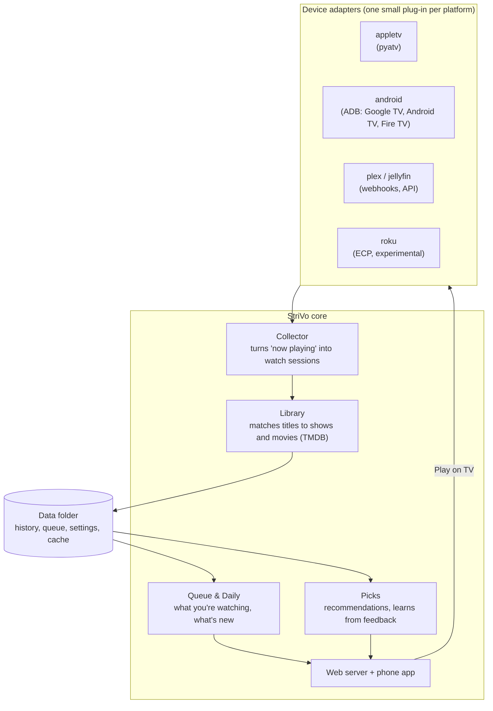

# Architecture

StriVo is deliberately small: one Python service and one web page, running on a computer in your home.



## Device adapters

Every platform is a plug-in with the same small interface:

```python
class Adapter:                                       # src/strivo/adapters/base.py
    kind = "appletv"                                 # unique id
    label = "Apple TV"

    async def discover(self, timeout) -> list[Device]: ...
    async def pair(self, device, prompt) -> Device: ...        # prompt("Type the code…") returns what the user typed
    async def now_playing(self, device) -> NowPlaying | None: ...
    async def launch(self, device, app, deep_link=None) -> None: ...

    # optional
    async def status(self, device) -> Status: ...              # online / power / current app, for Play on TV
    async def watch(self, device, emit, interval, stop): ...   # default polls now_playing(); Apple TV pushes
    def handle_webhook(self, payload, devices): ...            # Plex / Jellyfin webhooks
```

`NowPlaying` carries whatever the box reports: app, title, series name, season and episode, position, duration and play state. Missing fields stay empty; the core does the rest.

| Adapter | Module | How it hears "now playing" | How it opens apps |
|---|---|---|---|
| Apple TV | `adapters/appletv.py` | pyatv push updates (MRP over AirPlay) | pyatv Companion `launch_app` |
| Google TV / Android TV / Fire TV | `adapters/android.py` | ADB: `dumpsys media_session`, foreground activity, power state, polled | ADB: `monkey` on the TV launcher, or an `ACTION_VIEW` deep link |
| Jellyfin / Emby | `adapters/jellyfin.py` | `/Sessions` API, polled; Webhook plugin | n/a |
| Plex | `adapters/plex.py` | `/status/sessions` API, polled; Plex Pass webhooks | n/a |
| Roku *(experimental)* | `adapters/roku.py` | ECP `/query/active-app` and `/query/media-player`, polled | ECP `/launch/<channel>` |

App ids, title-parsing rules, deep-link templates and what each app is expected to report are **data**, in
`src/strivo/rules/compat.json`, so a fix can ship as a new rules file without new code. Health tracking, the daily
fix check and reports are described in [SELF-HEALING.md](SELF-HEALING.md).

Media servers can play on many screens at once, so each playback client becomes its own source in history
("Bedroom TV · Jellyfin"). Per-service app ids for each platform live in `src/strivo/apps.py`.

**Adding a platform means writing one adapter.** It doesn't touch the core, the database or the app. That's what makes it a good first contribution for someone who owns a device we don't.

## Core

- **Collector** (`collector.py`): runs every adapter's `watch()` on one asyncio loop and appends *changes* to the history in `strivo.db` (what, where, when). Reconnects with back-off and keeps per-box health for the Devices page.
- **History** (`history.py`): turns events into **watch sessions** and then into the queue, movies, Daily and stats. Per-app title rules (e.g. Hulu's "Show | S3 E4 - Name") live in `norm()`; anything that sends series/season/episode directly is trusted as-is.
- **Library** (`core.py`, `tmdb.py`): matches raw titles to shows and movies through TMDB, and caches posters, genres, episode lists and where-to-watch.
- **Queue & Daily**: series you're actively watching, sorted by new episodes; late-night, news and morning shows go to **Daily** instead. A series comes back to Watching when a new episode airs after your last watch, however long ago that was; one you removed comes back when a **new season** premieres (removing it again hides it until the next one).
- **Picks** (`picks.py`): movies, series and documentaries similar to what you watch, filtered to your services in your country, shaped by your "not interested because…" feedback.
- **Sports** (`sports/`): live games from a schedule provider, with where to watch mapped from the rules file. See [SPORTS.md](SPORTS.md).
- **Web server** (`server.py`): the phone app (`web/index.html`, one page, no build step), its JSON API, the setup wizard API and the webhook endpoints. Standard library only.

## Data

One data folder (`/data` in Docker, `~/.local/share/strivo` otherwise, or `--data`):

| File | What |
|---|---|
| `config.json` | Boxes, country, services, rules, picks settings |
| `secrets.json` | TMDB key and media-server tokens (file mode 0600; never served by the API) |
| `strivo.db` | Your history, kept forever: one row per change in what a box reported (SQLite; `store.py`). `strivo export` writes it all out as JSON Lines |
| `events.jsonl` | History from older versions (and NiVo). Imported into `strivo.db` automatically, then left as it was |
| `pyatv.json`, `adbkey` | Apple TV pairing credentials; this StriVo's ADB identity |
| everything else | Queue, Saved list, picks, feedback, TMDB cache |

Back up the folder and you have everything.

**History is never trimmed.** Screens show a window (Watching: 21 days, Daily: 7, news: 2, History: 90 days with
*Show older* for the rest), but every event stays in `strivo.db`. A rebuild reads only new rows, parses each title
once, and is reused while nothing changes, so five years of a busy household (about 340,000 events) refreshes in
about a second on a MacBook Air.

## Privacy boundary

The only outside services are **TMDB**, which receives show and movie titles to look up; **GitHub**, which gets one anonymous request a day for compatibility fixes (can be turned off), plus one anonymous search when you press *Check for an existing report* (app name, box type and problem only, to avoid duplicate reports); and, while the Sports tab is open, **ESPN's public scoreboard feed**, asked for each league's games by day. None of them ever receives your history, your teams, device names, or anything identifying.

## Tech choices

- **Python 3.11+**, standard library first; `pyatv` for Apple TV, `adb-shell` / `androidtv` for Android.
- **One HTML page** for the phone app (no build step), installable to the home screen.
- **Docker** for packaging, with host networking for device discovery.
