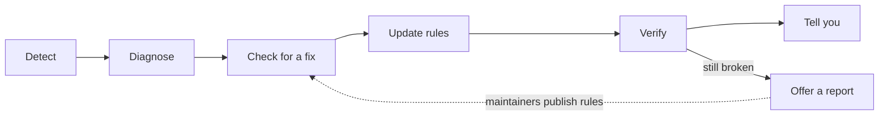

# Self-healing compatibility

Streaming apps change what they tell the box, often without notice. An app update renames a field or drops the
episode number, and tracking quietly stops. StriVo assumes this **will** happen. It watches for it, looks for a
fix, proves the fix worked, and tells you, so nobody in the house has to do maintenance.

## The principle

**Self-healing by design.** The parts of each integration that apps break are kept as *data* (a versioned rules
file), not code. Most breakage can be fixed by publishing a new rules file, which every StriVo picks up on its
daily check. StriVo never downloads or runs code on its own.

## The loop



1. **Detect.** For every box and every app, StriVo keeps a health state (below). An app is *degraded* when it's
   seen playing but stops reporting titles that the rules (or its own past) say it should send.
   **Not watching is never "broken".** Only actual playback counts, and an app must come up empty in three
   separate sessions before it's flagged, so movies, menus and ads don't trigger false alarms.
2. **Diagnose.** Deterministic rules explain the likely cause and next steps (Tier 1, below).
3. **Check for a fix.** Once a day (with back-off and caching, plus a "Check now" button) StriVo asks the project's
   GitHub releases for the newest rules file and StriVo version.
4. **Update.** A newer rules file is checked (checksum, schema, size, every regex compiles, minimum StriVo version,
   strictly newer) and then installed, offered, or ignored according to your setting. The previous copy is kept for
   one-tap rollback, and a damaged file always falls back to the copy bundled with StriVo. **A newer StriVo
   *version* is only announced; StriVo never installs code.**
5. **Verify.** Installing a fix proves nothing. A degraded app becomes *verifying* and only becomes *recovered*
   when a real title comes through again.
6. **Tell you.** Only real changes: "Hulu stopped reporting titles", "A fix was installed", "Hulu is tracking
   again". Never a daily "still broken". (Notifications go to the optional notify URL in Settings.)
7. **Contribute (opt-in).** For problems that don't heal, StriVo prepares a **prefilled GitHub issue link**. You
   see exactly what it contains, and you submit it yourself. StriVo holds no GitHub token and posts nothing.

## Health states

| | State | Meaning |
|---|---|---|
| Box | **healthy** | Reachable, and none of its apps is degraded |
| | **degraded** | Reachable, but an app on it stopped reporting titles |
| | **offline** | Can't be reached (off, asleep, network changed, debugging switched off) |
| | **unpaired** | Answered but refused StriVo's credentials: pair it again |
| | **paused** | You paused it in Devices |
| App | **healthy** | Reports what it's expected to |
| | **degraded** | Seen playing without titles in 3+ sessions when titles are expected |
| | **verifying** | A fix was installed; waiting for proof |
| | **recovered** | Titles are back after a problem |
| | **app-only** | A known limit (e.g. Netflix on Apple TV): not a failure, nothing to fix |
| | **unknown** | Not enough evidence yet |

StriVo also records when each app was last good, and the StriVo, rules and box OS versions at that time.

See it in **More › Settings › Health**, or run:

```bash
strivo doctor             # boxes, apps, rules version, last check for fixes, problems and next steps
strivo doctor --check     # check GitHub for fixes now
strivo doctor --apply     # install a waiting rules update (when set to "Ask me first")
strivo doctor --rollback  # undo the last rules update
strivo doctor --report KEY   # print the prefilled report link for one problem
```

## The rules file

`src/strivo/rules/compat.json`, bundled with every release and attached to every GitHub release (with
`compat.json.sha256`) by CI:

| Section | What | Example |
|---|---|---|
| `services` | App ids per platform, aliases | Hulu = `com.hulu.plus` (tvOS), `com.hulu.livingroomplus` (Android TV), Roku channel `2285` |
| `streaming`, `providers` | Services you can pick; TMDB provider names → services | "Amazon Prime Video with Ads" → Prime Video |
| `title_rules` | Per-app regexes that pull show / season / episode out of what the box sends | Hulu: `Show \| S43 E19 - Name`; Max: episode name in `title`, show in `artist` |
| `launch` | Deep-link templates | YouTube trailer on Android: `https://www.youtube.com/watch?v={id}` |
| `expect` | What each app is known to report on each platform | Hulu on Apple TV: `episode`; Netflix on Apple TV: `app-only` |

Fixing an app is usually a one-line change here, verified with a fixture test, and shipped in the next release
(or a rules-only release tagged `rules-YYYY.MM.DD`).

**Trust model today:** rules come only over HTTPS from the project's own GitHub releases, are integrity-checked
against the published SHA-256, and can't contain code (unknown sections are rejected; regexes are length-limited
and compiled before use). A detached signature with a maintainer key (so a compromised release page alone can't
push rules) is tracked as a follow-up issue.

## Settings

| Setting | Default | |
|---|---|---|
| Compatibility fixes (`rules_updates`) | **Install automatically** | or *Ask me first*, or *Don't check* |
| Daily check (`update_checks`) | on | One anonymous request to `api.github.com`, User-Agent `StriVo/<version>` |
| Diagnosis tier (`diagnosis.tier`) | 1 | See below |

## Intelligence tiers

| Tier | What | Status |
|---|---|---|
| **1 · Built-in rules** (default) | Deterministic health checks, known-issue explanations, update verification, rollback. No AI, no key, runs on a Pi. | **Built** |
| **2 · Local model** (optional) | A model on your own hardware reads *redacted* logs and suggests a likely cause or a draft rules change. | Interface only (`strivo/diagnose.py`) |
| **3 · Your own cloud key** (optional) | A frontier model you configure, for hard diagnoses or drafting a report or a rules change. Shows exactly what would be sent, and the cost, and asks first. | Interface only |

Whatever the tier, a model may only **propose**. It never runs code, installs anything or posts anything, and its
input always goes through `redact()` (addresses, MACs, long ids and credentials removed) and `sanitize()`.

## Privacy rules

- **Opt-in for anything that leaves the house** beyond the daily anonymous fix check (which you can turn off).
- **Your viewing history is never sent.** Not to GitHub, not to a model, not to the project.
- Reports contain only: adapter, platform, OS family, the app's public service name (unknown apps are just
  "another app"), failure type, expected vs observed, days since it last worked, StriVo and rules versions.
  **No titles, names, addresses, device ids, serials, accounts or tokens.** Tests enforce this.
- Before offering a new report, pressing **Check for an existing report** runs one anonymous GitHub search with just
  the app's public name, the platform and the failure type. If an open `compatibility` issue already matches, StriVo
  links to it so you can 👍 it instead of filing a duplicate. If GitHub is slow or unreachable, you get the normal
  report.
- **No ads, no selling data, no covert telemetry.** Community diagnostics exist to make StriVo work in more homes.
  Every report is previewed and submitted by a person.
